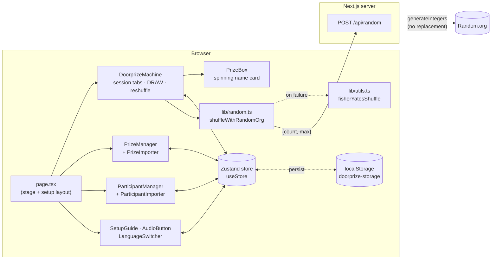
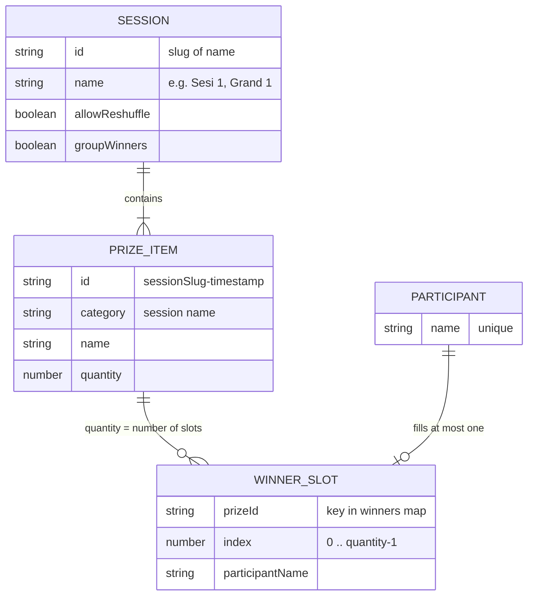
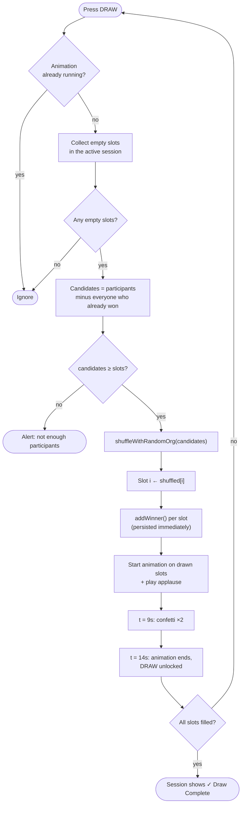
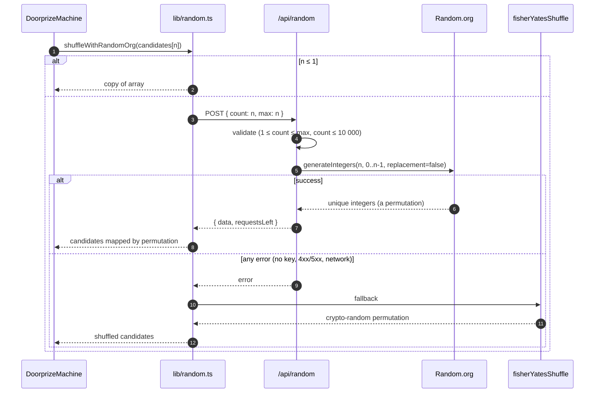
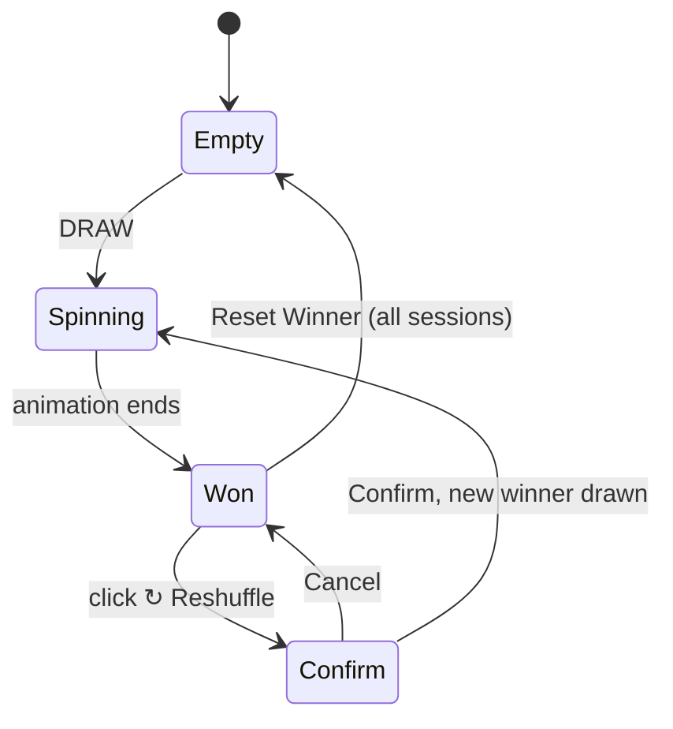
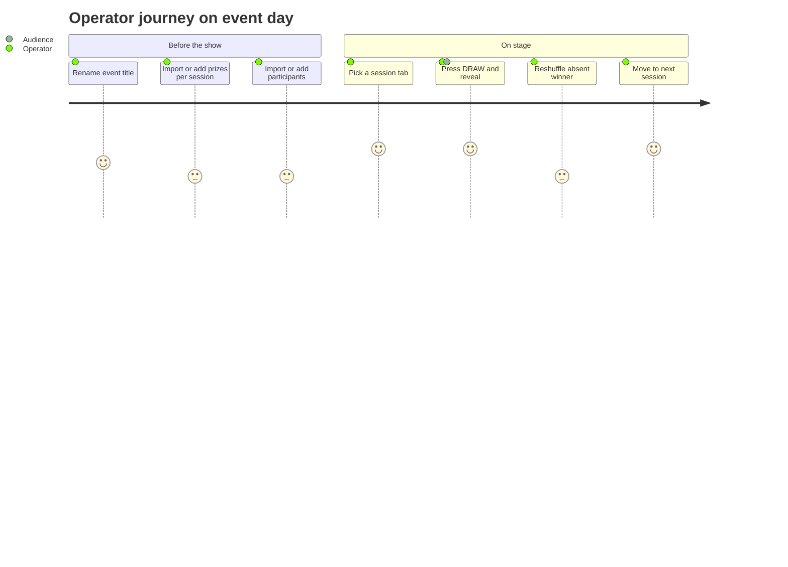
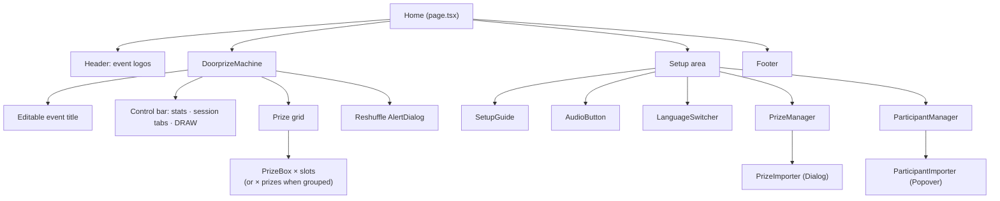

# Prize Batch Drawer

A single-page **doorprize / lucky-draw machine** for live events. Operators load a prize pool (organised into sessions) and a participant list, then press **DRAW** on stage: every open prize slot in the active session spins through names at once, lands on a winner, and celebrates with sound and confetti.

Winners are picked with **true randomness from [Random.org](https://www.random.org/)**, with a cryptographically secure local fallback, and nobody can win twice.

> Built for the *Collaboration FOC I — Pertamina Patra Niaga* event. Runs fully in the browser; the only server code is a thin proxy to Random.org.

---

## Table of Contents

- [Features](#features)
- [Tech Stack](#tech-stack)
- [How It Works](#how-it-works)
  - [Architecture](#architecture)
  - [Domain Model](#domain-model)
  - [Draw Flow](#draw-flow)
  - [Randomness & Fairness](#randomness--fairness)
  - [Draw Animation Timeline](#draw-animation-timeline)
  - [Reshuffle Flow](#reshuffle-flow)
  - [State & Persistence](#state--persistence)
- [Using the App](#using-the-app)
  - [1. Build the Prize Pool](#1-build-the-prize-pool)
  - [2. Add Participants](#2-add-participants)
  - [3. Run the Draw](#3-run-the-draw)
  - [Reset Actions](#reset-actions)
- [Excel Import Formats](#excel-import-formats)
- [Internal API](#internal-api)
- [Project Structure](#project-structure)
- [Known Limitations](#known-limitations)
- [Credits](#credits)

---

## Features

| Area | What it does |
| --- | --- |
| 🎰 **Batch draw** | One click fills *every* empty slot in the active session simultaneously, with a staggered stop so the reveal lands box by box. |
| 🎲 **True randomness** | Unique winner indices come from Random.org (`replacement: false`). If the service fails, it falls back to a Fisher–Yates shuffle driven by `crypto.getRandomValues` with rejection sampling (no modulo bias). |
| 🚫 **No double winners** | Anyone who has already won any prize is excluded from every later draw. |
| 🗂️ **Sessions** | Prizes are grouped into named sessions (e.g. *Sesi 1*, *Grand 1*); each session is its own tab on the stage. |
| 🔁 **Reshuffle** | Per-session option to redraw a single winner (e.g. absent winner) without touching the others. |
| 📦 **Group winners** | Per-session option to render all units of one prize as a single card listing every winner, instead of one card per unit. |
| 📥 **Excel import** | Bulk-load participants and prizes from `.xlsx`/`.xls`, with column auto-detection, column mapping, and row-level preview/selection for prizes. |
| 👑 **Winner tracking** | Winners are highlighted in the participant list and protected from removal. |
| 🔊 **Stage effects** | Name-cycling animation, applause soundtrack, double confetti burst; audio can be muted. |
| 🌐 **Bilingual UI** | English and Bahasa Indonesia, switchable at runtime. |
| ✏️ **Editable event title** | Click the headline to rename the event on screen. |
| 💾 **Auto-save** | Everything persists in `localStorage`, so a page refresh mid-event loses nothing. |
| 🧭 **Guided setup** | A three-step checklist ticks itself off as prizes, participants and the first draw are completed; contextual tooltips explain every control. |

## Tech Stack

| Concern | Choice |
| --- | --- |
| Framework | [Next.js 16](https://nextjs.org/) (App Router) + React 19 + TypeScript |
| State | [Zustand 5](https://zustand.docs.pmnd.rs/) with `persist` middleware (`localStorage`) |
| UI | [shadcn/ui](https://ui.shadcn.com/) on Radix primitives, Tailwind CSS v4, Lucide / Remix icons |
| Motion & effects | Framer Motion, `canvas-confetti`, HTML `Audio` |
| Randomness | [`random-org`](https://www.npmjs.com/package/random-org) JSON-RPC client (server-side), Web Crypto (fallback) |
| Spreadsheets | [SheetJS `xlsx`](https://sheetjs.com/) (parsed fully in the browser) |
| Fonts | IBM Plex Sans, Nunito, Roboto (Google Fonts) and a local *Excon* variable font for display text |

---

## How It Works

### Architecture

The whole app is one route (`/`). All business logic runs client-side against a single Zustand store; the server only exists to keep the Random.org API key secret.



### Domain Model



- A **prize** with `quantity: 3` expands into three **slots** (`<prizeId>-0`, `-1`, `-2`). Slots, not prizes, are what get drawn.
- Winners are stored as `winners: Record<prizeId, string[]>`, where the array position is the slot index.
- `allowReshuffle` and `groupWinners` are **session-level** settings. Adding or importing a prize into an existing session overwrites that session's settings with the ones chosen in the form.

### Draw Flow

What happens when the operator presses **DRAW** (`handleStartDraw` in `doorprize-machine.tsx`):



Key points:

- **Results are decided before the animation starts.** The spinning names are pure theatre; the winners are already saved to the store, so a refresh mid-spin keeps them.
- Session tabs and the DRAW button are disabled while the animation runs, so a draw can't be interrupted or doubled.
- Completed sessions get a ✓ on their tab.

### Randomness & Fairness



- Random.org returns `n` **unique** integers in `[0, n-1]`, which is a full random permutation of the candidate list. The first *k* entries become the winners for *k* slots.
- The fallback shuffle uses `crypto.getRandomValues` with **rejection sampling**, so every permutation is equally likely (no `Math.random`, no modulo bias).
- The draw never fails because of Random.org: the worst case is a silent (console-logged) switch to local randomness.
- `Math.random` is used **only** for the cosmetic name-cycling in `PrizeBox`, never for picking winners.

### Draw Animation Timeline

The timing is synced to the applause track (`/winner-sound-clap-final.mp3`): ~9 s of drum-roll, then ~5 s of celebration.

```mermaid
gantt
    title One batch draw (5 slots)
    dateFormat  X
    axisFormat  %ss

    section Audio
    Drum-roll / shuffle      :a1, 0, 9
    Celebration              :a2, 9, 14

    section Slots (stagger 0.5 s)
    Slot 0 spinning          :0, 7
    Slot 1 spinning          :0, 7.5
    Slot 2 spinning          :0, 8
    Slot 3 spinning          :0, 8.5
    Slot 4 spinning          :0, 9

    section Effects
    Confetti bursts          :milestone, 9, 9
    Controls unlocked        :milestone, 14, 14
```



Each card cycles random candidate names every **80 ms** and stops at `baseDuration + position × 500 ms`. The base is computed so the *last* card stops right when the drum-roll ends (`base = max(3000, 9000 − maxIndex × 500)`), giving a cascading reveal.

### Reshuffle Flow

Available only on sessions with **Allow Reshuffle** enabled, typically used when a called winner isn't present.



- Only the targeted slot animates; other winners are untouched.
- The replacement is drawn from participants who have **not** won anything.
- The replaced person is simply overwritten in the `winners` map. Because eligibility is derived from that map, **they become eligible again** for later draws.
- On single-unit prizes the ↻ button sits under the card; on grouped multi-unit cards it appears on hover next to each name.

### State & Persistence

All state lives in one Zustand store (`src/store/useStore.ts`) persisted under the `localStorage` key **`doorprize-storage`**.

| Slice | Type | Notes |
| --- | --- | --- |
| `eventName` | `string` | Editable headline on the stage. |
| `sessions` | `SessionData[]` | Prize pool, grouped by session. |
| `participants` | `string[]` | Unique names, in insertion order. |
| `winners` | `Record<prizeId, string[]>` | Slot index → winner name. |
| `isLocked` | `boolean` | Set on first winner, cleared on reset. |
| `language` | `"en" \| "id"` | UI language (default `en`). |
| `isAudioEnabled` | `boolean` | Mute toggle for the applause track. |

Derived values are never stored. "Available candidates", "winner badges" and "session complete" are all recomputed from `participants` + `winners` on every render, so state can't drift out of sync.

> ⚠️ Data is per-browser. Opening the app on another device or in a private window starts empty, and clearing site data wipes it. Use the same browser/profile for setup and the live show.

---

## Using the App

The page has two zones: the **stage** at the top (event title, session tabs, DRAW button, prize cards) and the **setup area** below (setup checklist, audio/language toggles, Prize Pool, Participants).



### 1. Build the Prize Pool

In **Prize Pool**, enter:

- **Session Name**: free text with autocomplete from existing sessions. Picking an existing session loads its settings.
- **Prize Name** and **Quantity** (≥ 1): quantity sets how many winners this prize gets.
- **Allow Reshuffle** / **Group Winners**: session-level options (see [Reshuffle Flow](#reshuffle-flow) and [Domain Model](#domain-model)).

Press **Add Prize** or Enter. Session name and options are kept for fast entry of the next item. Alternatively, use **Import Excel** to load many prizes at once. Remove a single prize with its trash icon; this also removes its recorded winners.

### 2. Add Participants

In **Participants**, type a name and press Enter (case-insensitive duplicate check), or **Import Excel** to bulk-load. Winners are marked with 👑, counted in the header badge, and can't be removed.

### 3. Run the Draw

1. Scroll to the stage and pick a session tab.
2. Press **DRAW**. All empty slots in that session spin and resolve.
3. If needed, reshuffle an individual winner.
4. Repeat for the next session. Each session shows **Draw Complete** once every slot is filled.

The header shows the remaining eligible candidates and filled/total slots for the active session.

### Reset Actions

| Button | Location | Clears | Keeps |
| --- | --- | --- | --- |
| **Reset Winner** | Prize Pool | All winners, all sessions | Prizes, participants |
| **Reset** (Prize Pool) | Prize Pool | All sessions, prizes **and** winners | Participants |
| **Reset** (Participants) | Participants | All participants who haven't won | Winners |

All resets ask for confirmation and can't be undone.

---

## Excel Import Formats

Both importers read the **first sheet** of an `.xlsx`/`.xls` file in the browser (nothing is uploaded). Row 1 must be a header row.

### Participants

| Name |
| --- |
| Andi Wijaya |
| Budi Santoso |
| Citra Lestari |

- Any column can hold the names; you choose it after selecting the file. A column named `Name` or `Nama` is picked automatically.
- Empty / non-text cells are skipped, values are trimmed, and names already in the list are ignored.

### Prizes

| Session | Prize | Qty |
| --- | --- | --- |
| Sesi 1 | Emergency Lamp | 3 |
| Sesi 1 | Setrika Philips | 3 |
| Grand 1 | TV Toshiba 43inch | 1 |

- Columns are mapped via dropdowns, auto-detected by header name (case-insensitive):

  | Field | Auto-detected headers | Required |
  | --- | --- | --- |
  | Session | `session`, `sesi`, `group`, `grup`, `kategori`, `category` | ✅ |
  | Prize name | `prize`, `hadiah`, `item`, `name`, `nama` | ✅ |
  | Quantity | `qty`, `quantity`, `jumlah` | Optional (defaults to 1; invalid/≤ 0 → 1) |

- A preview table lists every row with a checkbox. Rows missing a session or name are flagged and can't be selected. Untick rows you don't want.
- *Allow Reshuffle* / *Group Winners* chosen in the dialog apply to **every session touched by the import**.
- Imported prizes are **appended**; sessions with the same name are merged.

---

## Internal API

### `POST /api/random`

Server-side proxy to Random.org's `generateIntegers`, so the API key never reaches the browser.

**Request**

```json
{ "count": 5, "max": 120 }
```

Returns `count` **unique** integers in `[0, max − 1]`. Constraints: `1 ≤ count ≤ max`, `count ≤ 10000`.

**Responses**

| Status | Body | When |
| --- | --- | --- |
| `200` | `{ "data": number[], "requestsLeft": number }` | Success |
| `400` | `{ "error": "Invalid parameters: ..." }` | Bad `count` / `max` |
| `500` | `{ "error": "RANDOM_ORG_API_KEY is not configured" }` | No API key on the server |
| `502` | `{ "error": "<message>" }` | Random.org call failed |

Any non-200 response makes the client fall back to the local crypto shuffle.

---

## Project Structure

```text
src/
├── app/
│   ├── page.tsx                  # The single route: header, stage, setup area, footer
│   ├── layout.tsx                # Fonts, dark theme, TooltipProvider
│   ├── globals.css               # Tailwind v4 theme tokens
│   ├── api/random/route.ts       # Random.org proxy
│   ├── fonts/                    # Excon variable font
│   └── _components/              # Page-scoped components
│       ├── doorprize-machine.tsx # Stage: session tabs, DRAW, reshuffle, timing, confetti, audio
│       ├── prize-box.tsx         # One prize card + name-cycling animation
│       ├── prize-manager.tsx     # Prize Pool form, list, resets
│       ├── prize-importer.tsx    # Excel → prizes (mapping + row selection)
│       ├── participant-manager.tsx
│       ├── participant-importer.tsx
│       ├── setup-guide.tsx       # Self-completing 3-step checklist
│       ├── help-tip.tsx          # Hint / HelpTip tooltip helpers
│       ├── audio-button.tsx
│       └── language-switcher.tsx
├── components/ui/                # shadcn/ui primitives
├── store/useStore.ts             # Zustand store (persisted)
├── lib/
│   ├── random.ts                 # shuffleWithRandomOrg (+ fallback)
│   ├── utils.ts                  # cn(), fisherYatesShuffle()
│   └── translations.ts           # EN / ID dictionaries + useTranslation()
└── data/prizes.ts                # PrizeItem / SessionData types (+ sample PRIZE_DATA)
public/                           # Logos, applause audio, icons
```

### Component Tree



---

## Known Limitations

Observed while reviewing the code; useful to know before an event.

- **Single device, single browser.** No backend storage or sync; `localStorage` is the source of truth. There is no export of results, so record or screenshot winners before clearing data.
- **Names are identities.** Participants are keyed by exact name. Two different people with the same name can't both be entered, and import de-duplication only checks against existing names (not repeats within the same file).
- **Reshuffled winners re-enter the pool.** Someone replaced via reshuffle becomes eligible for later draws (see [Reshuffle Flow](#reshuffle-flow)).
- **`isLocked` is informational.** It's set after the first winner but doesn't currently block adding participants mid-event.
- **Session settings are last-write-wins.** Adding/importing into an existing session overwrites its *Allow Reshuffle* / *Group Winners* flags.
- **No batch-size rule.** A draw always fills all remaining slots of the session at once; a "minimum 4 per batch" rule exists only as commented-out code.
- **Autoplay policies.** The applause track starts on the DRAW click; if the browser blocks playback, the draw continues silently.
- `PRIZE_DATA` in `src/data/prizes.ts` is sample data and isn't loaded by the app; sessions start empty.

---

## Credits

Made with ♥️ by [codebyrzky](https://codebyrzky.site) for *Collaboration FOC I, Pertamina Patra Niaga*.
